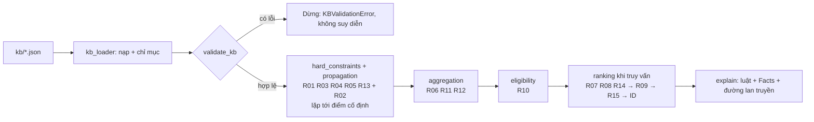

# Tổ chức cơ sở tri thức trên máy (Bước 4)

Tài liệu này mô tả cách CSTT của đề tài được lưu, nạp, kiểm tra, suy diễn và giải thích trên máy; cách mở rộng; cách chạy demo, kiểm thử và đóng gói. Mô hình biểu diễn (Bước 3) xem [model.md](model.md); bảng Concepts, Relations, Rules xem [concepts.md](concepts.md), [relations.md](relations.md), [rules.md](rules.md).

> Hệ thống chỉ mang tính tham khảo trong phạm vi tri thức đã mô hình hóa, không thay thế tư vấn của bác sĩ hoặc chuyên gia dinh dưỡng. Hồ sơ người dùng là dữ liệu giả lập.

## 1. Nguyên tắc tổ chức

- **Cơ sở tri thức** (dữ liệu + luật) nằm hoàn toàn trong `kb/*.json`. **Bộ máy suy diễn** (`src/*.py`) không chứa tên thực phẩm, tác nhân dị ứng, ngưỡng hay công thức nào của miền; mọi thứ đó được đọc từ JSON.
- Mỗi luật R01–R15 có hai phần trong cùng một bản ghi của `rules.json`: phần đặc tả cho người đọc (`if_all`/`if_any`/`then`, nguồn) và phần thực thi `exec` cho máy. Thêm luật cùng loại chỉ cần thêm JSON.
- Chỉ dùng thư viện chuẩn Python (đã chạy trên Python 3.10), nên chạy được trên máy sạch không cần cài thêm gì.

## 2. Cấu trúc thư mục

```text
CS217-FoodNutritionKB/
├── kb/                         CƠ SỞ TRI THỨC (dữ liệu + luật)
│   ├── concepts.json           10 Concepts và Attributes (kiểu, enum, ràng buộc)
│   ├── relations.json          12 Relations: domain/range, bội số, thuộc tính cạnh, chính sách phủ định
│   ├── facts.json              thực thể, 572 cạnh khẳng định, 11 cạnh phủ định, 15 nguồn
│   └── rules.json              15 luật (đặc tả + exec), evaluation_plan, status_order, comparison_basis
├── src/                        BỘ MÁY SUY DIỄN VÀ CÔNG CỤ
│   ├── kb_loader.py            nạp 4 JSON, đánh chỉ mục, truy vấn quan hệ 3 giá trị
│   ├── rule_dsl.py             đặc tả ngôn ngữ exec, bộ tính biểu thức an toàn, kiểm tra cấu trúc luật
│   ├── validate_kb.py          kiểm tra tính hợp lệ của CSTT (CLI)
│   ├── engine.py               suy diễn tiến theo evaluation_plan, xếp hạng
│   ├── explain.py              cơ chế giải thích bằng tiếng Việt
│   ├── demo_queries.py         CLI truy vấn và kịch bản demo
│   └── package_kb.py           đóng gói ZIP nộp bài kèm bằng chứng chạy thử
├── tests/
│   ├── test_cases.md           14 ca đặc tả: input, expected, actual_result (do chương trình ghi)
│   ├── case_runner.py          chạy từng TC, đọc input/expected trực tiếp từ test_cases.md
│   ├── test_cases_md.py        mỗi TC là một unit test
│   ├── test_validate.py        từng loại lỗi của validator
│   ├── test_engine.py          luật chính và trường hợp biên (dị ứng luôn bị loại...)
│   └── update_case_results.py  ghi kết quả thật vào actual_result
└── docs/                       concepts.md, relations.md, rules.md, model.md, kb_organization.md
```

## 3. Định dạng từng tệp

### 3.1. `kb/concepts.json`

```json
{"concepts": [{"id": "food", "display_name": "Food", "description": "...", "syntax": "food(id)",
  "attributes": [{"name": "origin", "type": "string", "required": true,
                  "enum": ["plant", "dairy", "egg", "meat", "seafood", "unknown"]}],
  "example_id": "food_rice_cooked", "related_rule_ids": ["R01", "..."], "_meta": {"source_ids": ["..."]}}]}
```

Thuộc tính hỗ trợ: `type` (`string`, `integer`, `number`, `object`, `null` hoặc danh sách), `required`, `enum`, `const`, `minimum`, `exclusive_minimum`; với `object`: `properties` và `required_fields`. Validator kiểm tra mọi thực thể trong `facts.entities` theo đúng các khai báo này.

### 3.2. `kb/relations.json`

Mỗi quan hệ có `name`, `domain`, `range` (là ID concept), `cardinality.objects_per_subject` / `subjects_per_object` (dạng `0..*`, `1..1`, `3..3`...), `edge_attributes` (đặc tả thuộc tính trên cạnh như `amount_g`, `servings`, `preference`) và `negative_rules`. Trường `status_attribute` trong `negative_rules` cho máy biết thuộc tính trạng thái dùng để suy phủ định theo danh mục đã đánh giá đầy đủ (`contains_allergen` → `food.allergen_status`, `compatible_with_diet` → `food.diet_status`).

### 3.3. `kb/facts.json`

| Mục | Nội dung |
|---|---|
| `entities.<concept>` | danh sách thực thể của từng concept; mỗi bản ghi có `id` duy nhất toàn CSTT |
| `edges` | cạnh khẳng định `{id, relation, subject_id, object_id, attributes, _meta.source_ids}` |
| `negative_edges` | phủ định tường minh, cùng cấu trúc; chỉ cho quan hệ có `negative_rules` |
| `sources` | danh mục nguồn; mọi `source_ids` trong CSTT phải trỏ tới đây |

Hàm lượng dinh dưỡng là thực thể `nutrient_content` (giá trị trên `basis_g = 100` g phần ăn được), nối với food qua `has_nutrient_content` và với chất qua `measures_nutrient`. Giá trị chưa biết giữ `status = unknown`, `value = null`, không bao giờ ghi 0.

### 3.4. `kb/rules.json` và ngôn ngữ `exec`

```json
{"id": "R01", "name": "...", "phase": "hard_constraints", "priority": 100, "kind": "hard",
 "if_all": ["allergic_to(u,a)", "contains_allergen(f,a)"], "then": {"...": "đặc tả cho người đọc"},
 "concept_ids": ["..."], "relation_names": ["..."], "source_ids": ["source_fda", "source_design"],
 "exec": {
   "when": [{"rel": "allergic_to", "args": ["?u", "?a"]},
            {"rel": "contains_allergen", "args": ["?f", "?a"], "truth": "true"}],
   "then": {"action": "set_status", "target": "?f", "value": "rejected", "reason": "allergen_match"}}}
```

`exec.when` là hội (AND) các điều kiện; `exec.when_any` là tuyển (OR) các nhánh, mỗi nhánh có `when`, `detail` và có thể có `target` riêng. Biến bắt đầu bằng `?`; `?u` luôn là người dùng đang xét.

| Điều kiện | Ý nghĩa |
|---|---|
| `{"rel": R, "args": [s, o], "truth": "true\|false\|unknown", "where": {...}}` | quan hệ R với giá trị chân lý 3 giá trị (mục 4); `where` lọc thuộc tính cạnh |
| `{"each": concept, "var": "?x"}` | duyệt mọi thực thể của concept |
| `{"attr": "?x.a.b", "op": OP, "value": V}` | so sánh thuộc tính; OP ∈ eq, ne, in, not_in, lt, le, gt, ge, missing, present |
| `{"expr": "biểu thức", "op": OP, "value": V}` | biểu thức số học trên thuộc tính (ví dụ BMI ở R13); thiếu dữ liệu thì giá trị là null |
| `{"goal_nutrient": ["?u", "?n"]}` | chất dinh dưỡng mục tiêu của u, lấy từ các luật xếp hạng `goal_metric` |
| `{"nutrient_value": ["?f", "?n"], "truth": "known\|unknown"}` | hàm lượng đã biết hay chưa |
| `{"status": "?x", "value": S}` | trạng thái đã suy ra (cho phép luật phụ thuộc kết luận khác; engine lặp tới điểm cố định) |

| Hành động (`then.action`) | Pha | Dùng ở |
|---|---|---|
| `set_status`, `set_status_unless_rejected` | hard_constraints | R01, R03, R04, R05, R13 |
| `propagate_status` | propagation | R02 |
| `aggregate_nutrients`, `lookup_table`, `energy_target` | aggregation | R06, R11, R12 |
| `set_eligible` | eligibility | R10 |
| `goal_metric`, `preference_score`, `group_coverage` | ranking | R07, R08, R14, R09, R15 |

`rule_dsl.check_exec` kiểm tra cấu trúc này (quan hệ, concept, hằng là ID có thật, biến đích đã được gán, hành động đúng pha...) như một phần của `validate_kb`.

## 4. Quy trình nạp và suy diễn



- Thứ tự pha đọc từ `rules.json#evaluation_plan`; trong một pha, luật priority cao chạy trước, cùng priority thì theo mã luật.
- **Quan hệ 3 giá trị** (`KnowledgeBase.holds`): có cạnh khẳng định → `true`; có cạnh phủ định → `false`; không có cạnh mà thuộc tính `status_attribute` của subject là `complete` → `false`; ngược lại → `unknown`. Quan hệ không khai báo `negative_rules` (khai báo của người dùng) dùng thế giới đóng; trạng thái `unknown` của hồ sơ do R05 xử lý.
- **Trạng thái**: `rejected` > `requires_review` > `eligible_in_model`. Mọi lý do đều được giữ (ví dụ TC05 có cả `diet_mismatch` và `explicit_avoid`); trạng thái cuối là lý do nặng nhất, nên sở thích không bao giờ gỡ được lệnh loại.
- **Xếp hạng** chỉ so ứng viên eligible cùng concept và cùng cơ sở (`comparison_basis`: Food/100 g, Dish/khẩu phần, Meal/cả bữa, Menu/một ngày), theo thứ tự priority của các luật pha ranking, cuối cùng theo ID tăng dần (R10).

## 5. Cơ chế giải thích

Mỗi kết luận là một `Justification(rule_id, value, reason, detail, premises, via, relation, notes)`:

- `premises`: ID Facts tiền đề (`fact_0552`, `negative_fact_0002`, `nc_shrimp_cooked_fiber`) hoặc thuộc tính (`user_vy.allergy_status=unknown`), hoặc biểu thức đã tính (`58 / (172 / 100) ** 2 = 19.61`);
- `via`: thành phần con khi kết luận được R02 lan truyền, đủ để dựng đường `food_milk_whole -> dish_oat_milk -> meal_ordinary_breakfast -> menu_ordinary`;
- `notes`: xung đột được ghi nhận, ví dụ tránh thắng thích (R04).

Ví dụ thật (`python src/demo_queries.py check user_quang dish_rice_chicken`):

```text
dish_rice_chicken — Cơm, ức gà và bông cải [dish] với user_quang: BỊ LOẠI
  • R03 (Loại food không phù hợp chế độ ăn): không phù hợp chế độ ăn
      tiền đề: follows_diet(user_quang, diet_vegan) [fact_0558]
      tiền đề: Not(compatible_with_diet(food_chicken_roasted, diet_vegan)) [negative_fact_0002]
      lan truyền R02: food_chicken_roasted -> dish_rice_chicken
  • R04 (Loại food người dùng cần tránh): người dùng khai báo cần tránh
      tiền đề: avoids_food(user_quang, food_chicken_roasted) [fact_0560]
      ghi chú: người dùng vừa thích vừa cần tránh; ràng buộc tránh thắng sở thích [fact_0561]
      lan truyền R02: food_chicken_roasted -> dish_rice_chicken
  Luật đã kích hoạt cho dish_rice_chicken: R02, R03, R04
```

Kết quả xếp hạng cũng nêu luật quyết định từng cặp liền kề, ví dụ `menu_vegetarian trước menu_vegan_peanut_free do R15: phủ 6/6 nhóm so với phủ 5/6 nhóm, thiếu group_dairy`. Thêm `--json` để lấy toàn bộ cấu trúc giải thích dạng máy đọc được.

## 6. Kiểm tra tính hợp lệ (`validate_kb.py`)

| Mã lỗi | Ý nghĩa |
|---|---|
| `json_error`, `missing_section` | tệp không đọc được hoặc thiếu mục bắt buộc |
| `duplicate_id`, `duplicate_edge`, `duplicate_nutrient_content` | trùng ID / trùng bộ (relation, subject, object) / trùng cặp food–nutrient |
| `unknown_concept`, `unknown_relation`, `unknown_source`, `unknown_rule`, `unknown_attribute` | tham chiếu tới khai báo không tồn tại |
| `dangling_reference`, `domain_mismatch`, `range_mismatch` | đầu mút cạnh không tồn tại hoặc sai concept |
| `missing_attribute`, `type_mismatch`, `enum_violation`, `const_violation`, `value_out_of_bounds` | thực thể sai đặc tả trong concepts.json |
| `edge_attribute_missing`, `non_positive_amount` | thuộc tính cạnh thiếu hoặc ≤ 0 (`amount_g`, `servings`) |
| `cardinality_violation`, `menu_meal_types` | sai bội số; Menu không đủ đúng một bữa sáng/trưa/tối |
| `positive_negative_conflict`, `negative_not_allowed` | vừa khẳng định vừa phủ định; phủ định cho quan hệ không cho phép |
| `nutrient_status_mismatch` | `known` thiếu giá trị/nguồn, hoặc `unknown` nhưng có giá trị (kể cả 0) |
| `rule_invalid` | luật sai kind/priority/pha hoặc `exec` sai cấu trúc |
| `atwater_mismatch` (cảnh báo) | năng lượng lệch quá xa 4P + 9L + 4C; cần kiểm chứng số liệu |

Engine gọi validator trước khi suy diễn và từ chối chạy nếu còn lỗi (TC10).

## 7. Mở rộng CSTT

**Thêm thực phẩm**: thêm bản ghi `food` (có `food_state`, `origin`, `allergen_status`, `diet_status`, `_meta.fdc_id`); 6 bản ghi `nutrient_content` lấy từ nguồn có mã bản ghi (USDA hoặc Bảng thành phần thực phẩm Việt Nam) cùng 6 cạnh `has_nutrient_content` và 6 cạnh `measures_nutrient`; 1 cạnh `belongs_to_group`; các cạnh `contains_allergen` đã kiểm chứng; `compatible_with_diet` / `negative_edges` cho 3 chế độ. Giá trị chưa có nguồn thì để `status: unknown`, `value: null`, không tự điền. Sau đó chạy `python src/validate_kb.py`; validator sẽ báo nếu thiếu bội số (ví dụ thiếu nhóm) hoặc năng lượng lệch Atwater.

**Thêm món / bữa / thực đơn**: thêm `dish` + cạnh `uses_ingredient` (`amount_g`, `unit: g`, `quantity_basis: recipe_total`); `meal` + `contains_dish` (`servings`); `menu` + đúng 3 `contains_meal` (sáng/trưa/tối).

**Thêm hồ sơ người dùng**: thêm `user_profile` và đúng một cạnh `follows_diet`; dị ứng (`allergic_to`), cần tránh (`avoids_food`), sở thích (`prefers_food`) tùy chọn. Nếu chưa hỏi đủ dị ứng thì để `allergy_status: unknown`; hệ thống sẽ không kết luận đủ điều kiện (R05). Mục tiêu `lose_weight` cần `weight_kg` và `height_cm` (R13).

**Thêm luật mới bằng JSON** (không sửa engine), ví dụ loại cả một nhóm thực phẩm:

```json
{"id": "R16", "name": "Loại thực phẩm thuộc nhóm chất béo", "phase": "hard_constraints", "priority": 100,
 "kind": "hard", "if_all": ["belongs_to_group(f, group_fats_oils)"], "then": {"action": "set_status"},
 "concept_ids": ["food", "food_group"], "relation_names": ["belongs_to_group"], "source_ids": ["source_design"],
 "exec": {"when": [{"rel": "belongs_to_group", "args": ["?f", "group_fats_oils"]}],
          "then": {"action": "set_status", "target": "?f", "value": "rejected", "reason": "group_excluded"}}}
```

Luật này đã được thử trong `tests/test_engine.py` (`Extensibility`): R02 tự lan truyền lên các món có dầu ô liu mà không cần sửa mã. Tương tự, đổi tham số chỉ cần sửa JSON: ngưỡng BMI của R13 (`"value": 25`), mức thâm hụt hoặc sàn năng lượng của R12, bảng của R11, nhóm cần phủ của R15. Chỉ khi cần **loại hành động mới** (khác các hành động ở mục 3.4) mới phải thêm một hàm xử lý trong `engine.py` và khai báo nó trong `rule_dsl.ACTIONS`.

## 8. Cách chạy

Từ thư mục gốc của repo (Windows, macOS, Linux; Python ≥ 3.10):

```bash
python src/validate_kb.py                    # kiểm tra CSTT (thêm --json, --strict)
python src/demo_queries.py demo              # kịch bản minh họa cho 7 hồ sơ mẫu
python src/demo_queries.py users             # danh sách hồ sơ
python src/demo_queries.py lookup food_rice_cooked
python src/demo_queries.py check user_minh menu_ordinary
python src/demo_queries.py nutrients dish_rice_chicken
python src/demo_queries.py recommend user_an --level menu      # --level food|dish|meal|menu, --top N
python src/demo_queries.py compare user_minh dish_rice_chicken dish_chickpea_salad
python src/demo_queries.py rules
python -m unittest discover -s tests         # 65 test (hoặc: python -m pytest tests)
python tests/update_case_results.py          # chạy 14 TC và ghi actual_result vào test_cases.md
python src/package_kb.py                     # tạo dist/CS217_TH2_Nhom1_KnowledgeBase.zip kèm bằng chứng
```

## 9. Giới hạn

- `eligible_in_model` chỉ nghĩa là đạt các ràng buộc đã mô hình hóa (5 tác nhân dị ứng, 3 chế độ ăn, danh sách tránh); chưa xét nhãn sản phẩm, nhiễm chéo hay bệnh lý.
- R11 dùng bảng ước tính theo tuổi/giới/mức vận động của DGA 2020–2025, áp cho người trưởng thành không mang thai/cho con bú; ánh xạ `low/moderate/high` sang `Sedentary/Moderately Active/Active` là quyết định của nhóm. R12–R14 chỉ xếp hạng các thực đơn mẫu, không phải phác đồ giảm cân; R13 chuyển mọi hồ sơ giảm cân chưa xác nhận thừa cân (BMI ≥ 25) sang "cần xem xét".
- Các thực đơn mẫu chỉ cung cấp khoảng 1035–1439 kcal/ngày, thấp hơn nhu cầu ước tính của đa số hồ sơ (R12 hiển thị tỷ lệ đáp ứng); chúng minh họa cấu trúc, không phải thực đơn khuyến nghị.
- Nhóm thực phẩm của bài là thiết kế riêng: khoai tây thuộc `group_starch` và bơ quả thuộc `group_fruits`, trong khi DGA xếp hai loại này vào rau; bơ sữa nằm trong `group_fats_oils`.
