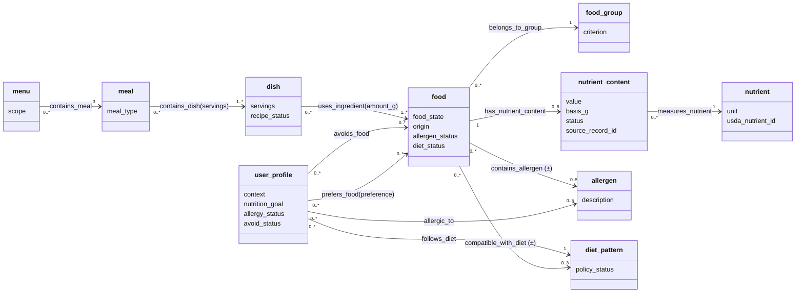
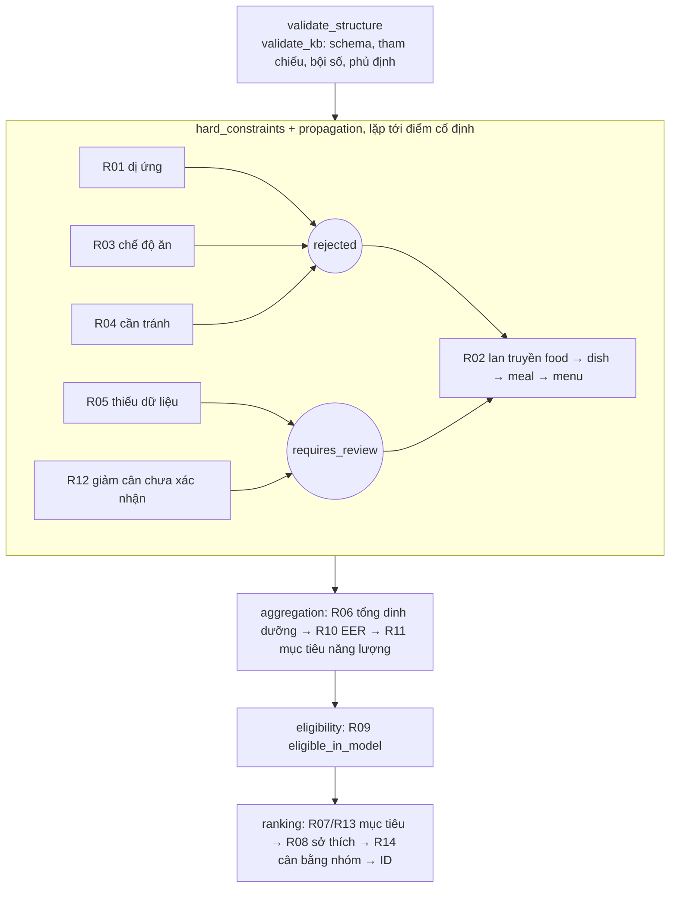
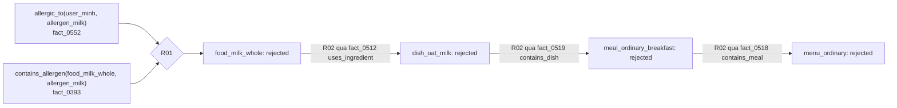

# Mô hình biểu diễn tri thức (Bước 3)

> **Ghi chú phân công:** theo README, "Mô hình biểu diễn và Rules IF–THEN" là phần của Võ Hoài Chiều. Tài liệu này do Bùi Huy Chương viết để hỗ trợ, tổng hợp từ các tệp đã có ([concepts.md](concepts.md), [relations.md](relations.md), [rules.md](rules.md), `kb/*.json`), **cần Chiều duyệt**. Các luật cơ bản do Chiều đặc tả; R10–R14 do Chương bổ sung trong TH2, cần nhóm duyệt.

> Hệ thống chỉ mang tính tham khảo trong phạm vi tri thức đã mô hình hóa, không thay thế tư vấn của bác sĩ hoặc chuyên gia dinh dưỡng.

## 1. Mô hình lựa chọn và lý do

Nhóm chọn mô hình **Concepts – Attributes – Relations – Facts – Rules** (README). Mô hình này phù hợp với bài toán tư vấn dinh dưỡng vì:

- **Đối tượng có cấu trúc thuộc tính rõ ràng**: thực phẩm có trạng thái chế biến, nguồn gốc, hàm lượng trên 100 g; người dùng có tuổi, giới, mức vận động, mục tiêu. Concept + Attribute (giống frame) mô tả được kiểu và ràng buộc của từng trường.
- **Quan hệ nhiều–nhiều có thuộc tính trên cạnh**: món dùng nhiều nguyên liệu với `amount_g`, bữa gồm nhiều món với `servings`. Relations có domain/range, bội số và `edge_attributes`.
- **An toàn đòi hỏi phân biệt "không" với "chưa biết"**: thiếu cạnh "chứa dị nguyên" không có nghĩa là an toàn. Facts gồm cả cạnh khẳng định lẫn phủ định, kèm ngữ nghĩa 3 giá trị.
- **Suy luận gồm loại trừ, tính toán và ưu tiên**: Rules IF–THEN chia theo pha giúp ràng buộc cứng luôn được xét trước ưu tiên mềm, và mỗi kết luận truy vết được.
- **Lưu trữ khớp ví dụ JSON/Python trong slide** (trang 13–14), tách tri thức (JSON) khỏi chương trình.

## 2. Mô tả hình thức

Cơ sở tri thức là bộ năm

$$K = (C,\ A,\ Rel,\ F,\ R)$$

| Thành phần | Định nghĩa | Lưu ở |
|---|---|---|
| `C` | Tập 10 concept: food, food_group, nutrient, nutrient_content, allergen, dish, meal, menu, user_profile, diet_pattern | `concepts.json#concepts` |
| `A` | `A(c) = {(a, τ, κ)}`: tên thuộc tính `a`, kiểu/miền giá trị `τ` (string, integer, number, object, enum, null), ràng buộc `κ` (required, const, minimum, exclusive_minimum, required_fields) | `concepts.json#concepts[].attributes` |
| `Rel` | `r = (name, dom, ran, card, E_attr, neg)`: miền và miền giá trị thuộc `C`, bội số `card = (objects_per_subject, subjects_per_object)`, thuộc tính cạnh `E_attr`, chính sách phủ định `neg` | `relations.json#relations` |
| `F` | `F = (E, F⁺, F⁻, S)`: thực thể `e = (id, c, val)` với `val` thỏa `A(c)`; cạnh khẳng định `F⁺ ⊆ Rel × E × E × attrs`; cạnh phủ định tường minh `F⁻`; nguồn `S` | `facts.json#entities, edges, negative_edges, sources` |
| `R` | `ρ = (id, phase, priority, kind, LHS, RHS, sources)`, `kind ∈ {hard, soft, calculation}`, `phase ∈ P = ⟨hard_constraints, propagation, aggregation, eligibility, ranking⟩` | `rules.json#rules` (đặc tả + `exec`) |

Các **hàm tính toán** (tổng dinh dưỡng, nhu cầu năng lượng, BMI, điểm sở thích, độ phủ nhóm) không là thành phần riêng; chúng là vế phải của luật loại `calculation` (R06, R10, R11) hoặc nằm trong điều kiện/điểm xếp hạng (R08, R12, R13, R14), được khai báo dạng dữ liệu trong `exec`.

**Ký hiệu.** `r(x, y)` là quan hệ khẳng định; `Not(r(x, y))` là phủ định; `x.a` là thuộc tính; `status(u, x) ∈ {rejected, requires_review, eligible_in_model}` là kết luận cho người dùng `u` và ứng viên `x`; `N(x, n)` là hàm lượng chất `n` của `x` theo cơ sở so sánh của concept.

### 2.1. Ngữ nghĩa 3 giá trị của quan hệ

$$
⟦r(x,y)⟧ =
\begin{cases}
\text{true} & (r,x,y) \in F^+\\
\text{false} & (r,x,y) \in F^-\\
\text{false} & neg(r) \text{ có } status\_attribute\ s \text{ và } x.s = complete\\
\text{unknown} & \text{còn lại}
\end{cases}
$$

Áp dụng cho `contains_allergen` (`s = allergen_status`) và `compatible_with_diet` (`s = diet_status`). Các quan hệ khai báo của người dùng (`allergic_to`, `avoids_food`, `prefers_food`) dùng thế giới đóng; độ đầy đủ của khai báo do thuộc tính `allergy_status`/`avoid_status` và R05 xử lý. Ràng buộc nhất quán: `F⁺ ∩ F⁻ = ∅`.

### 2.2. Trạng thái, xung đột và suy diễn

- Thứ tự trạng thái: `rejected ≻ requires_review ≻ eligible_in_model`; `status(u, x)` là trạng thái nặng nhất trong mọi kết luận về `x`, nên luật ưu tiên mềm không bao giờ gỡ được kết luận của luật cứng.
- Suy diễn tiến theo pha `P`; pha `hard_constraints + propagation` lặp tới **điểm cố định** (không còn kết luận mới). Trong một pha, priority lớn hơn xét trước, cùng priority thì theo mã luật.
- Xếp hạng là thứ tự từ điển trên các luật pha `ranking` theo priority, cuối cùng theo ID tăng dần, và chỉ so ứng viên `eligible_in_model` cùng concept, cùng cơ sở (`comparison_basis`: Food/100 g, Dish/khẩu phần, Meal/cả bữa, Menu/một ngày).
- Mỗi kết luận lưu `(mã luật, lý do, Facts tiền đề, thành phần con)`, là cơ sở của cơ chế giải thích.

## 3. Ánh xạ thành phần tri thức (Bước 1) vào mô hình

| Concept (C) | Thuộc tính chính (A) | Ví dụ Facts (F) | Vai trò trong luật (R) |
|---|---|---|---|
| `food` | food_state, origin, allergen_status, diet_status | `food_milk_whole` (dairy, complete/complete) | đối tượng chính của R01, R03–R05, R12; ứng viên cấp 1 |
| `food_group` | name, criterion | `group_dairy` | phân loại; R14 đếm nhóm có mặt |
| `nutrient` | unit, usda_nutrient_id | `nutrient_protein` (g, 1003) | đơn vị và chất mục tiêu (R06–R07, R11, R13) |
| `nutrient_content` | value, basis_g = 100, status, source_id, source_record_id | `nc_shrimp_cooked_fiber` (unknown, null) | số liệu đầu vào R06; `unknown` kích hoạt R05 |
| `allergen` | name, description | `allergen_peanut` | vế trái R01; loại nhóm sữa trong R14 |
| `dish` | servings, recipe_status | `dish_rice_chicken` (1 khẩu phần) | ứng viên cấp 2; R02 lan truyền, R06 tổng hợp |
| `meal` | meal_type ∈ {breakfast, lunch, dinner} | `meal_ordinary_breakfast` | ứng viên cấp 3 |
| `menu` | scope = one_day | `menu_ordinary` | ứng viên cấp 4; R11, R13, R14 |
| `user_profile` | context (age, sex, activity, weight_kg?, height_cm?), nutrition_goal, allergy_status, avoid_status | `user_minh`, `user_an` | chủ thể suy luận `?u` của mọi luật |
| `diet_pattern` | policy_description, policy_status | `diet_vegan` | vế trái R03; `policy_status = unknown` kích hoạt R05 |

Các loại tri thức của TH1 được biểu diễn như sau: **khái niệm** → `C`; **thuộc tính** → `A`; **quan hệ** → `Rel`; **sự kiện** (thực phẩm, hàm lượng, công thức, hồ sơ) → `F`; **luật** (loại trừ, tính toán, ưu tiên) → `R`; **ràng buộc** dữ liệu (kiểu, enum, bội số, `F⁺ ∩ F⁻ = ∅`) → `A`, `card`, `neg` (do `validate_kb` kiểm tra); **kinh nghiệm/heuristic** (ưu tiên mục tiêu, sở thích, cân bằng nhóm) → luật `soft`.

## 4. Ánh xạ quan hệ (Bước 2) vào mô hình

| Mã | Quan hệ | Lưu trong F | Thuộc tính cạnh | Phủ định | Luật dùng |
|---|---|---|---|---|---|
| REL01 | `belongs_to_group(food, food_group)` 1..1 | `edges` | — | — | R14 |
| REL02 | `has_nutrient_content(food, nutrient_content)` 0..6 | `edges` | — | — | R05, R06 |
| REL03 | `measures_nutrient(nutrient_content, nutrient)` 1..1 | `edges` | — | — | R05, R06 |
| REL04 | `uses_ingredient(dish, food)` 1..* | `edges` | amount_g > 0, unit = g, quantity_basis = recipe_total | — | R02, R06, R08, R14 |
| REL05 | `contains_allergen(food, allergen)` 0..5 | `edges` + `negative_edges` | — | 3 giá trị theo `allergen_status` | R01, R05 |
| REL06 | `allergic_to(user_profile, allergen)` 0..5 | `edges` | — | thế giới đóng + `allergy_status` | R01, R05, R14 |
| REL07 | `follows_diet(user_profile, diet_pattern)` 1..1 | `edges` | — | — | R03, R05, R14 |
| REL08 | `compatible_with_diet(food, diet_pattern)` 0..3 | `edges` + `negative_edges` | — | 3 giá trị theo `diet_status` | R03, R05 |
| REL09 | `contains_dish(meal, dish)` 1..* | `edges` | servings > 0 | — | R02, R06 |
| REL10 | `contains_meal(menu, meal)` 3..3 | `edges` | — | — | R02, R06 |
| REL11 | `avoids_food(user_profile, food)` 0..* | `edges` | — | thế giới đóng + `avoid_status` | R04, R05 |
| REL12 | `prefers_food(user_profile, food)` 0..* | `edges` | preference ∈ {like, dislike} | — | R04 (ghi xung đột), R08 |

**Quan hệ dẫn xuất (không lưu, không thêm Relation thứ 13):** `children(x)` = các con của `x` qua REL04 ∪ REL09 ∪ REL10 (lấy từ `exec.via` của R02); `foods(x)` = bao đóng bắc cầu của `children` xuống food; `status(u, x)`; `N(x, n)` (R06); `energy_requirement(u)`, `energy_target(u)`, `energy_ratio(u, menu)` (R10–R11).

## 5. Sơ đồ

### 5.1. Cấu trúc khái niệm và quan hệ

`(±)` đánh dấu quan hệ có cả cạnh khẳng định và phủ định (ngữ nghĩa 3 giá trị).

### 5.2. Các pha suy luận

### 5.3. Một chuỗi suy luận thật (TC03)

## 6. Danh sách luật và phân loại

| Mã | Phân loại | Biểu diễn hình thức | Nguồn / lý do |
|---|---|---|---|
| R01 | Ràng buộc – loại bỏ | `allergic_to(u,a) ∧ ⟦contains_allergen(f,a)⟧ = true → status(u,f) = rejected` [allergen_match] | FDA (dị ứng thực phẩm); thiết kế nhóm |
| R02 | Ràng buộc – lan truyền | `child(x,y) ∧ status(u,y) = s, s ∈ {rejected, requires_review} → status(u,x) ⪰ s` | Món/bữa/thực đơn không an toàn nếu một thành phần không an toàn; thiết kế nhóm |
| R03 | Ràng buộc – loại bỏ | `follows_diet(u,d) ∧ ⟦compatible_with_diet(f,d)⟧ = false → rejected` [diet_mismatch] | NHS: chế độ chay, thuần chay |
| R04 | Ràng buộc – loại bỏ | `avoids_food(u,f) → rejected` [explicit_avoid]; nếu thêm `prefers_food(u,f) = like` thì ghi xung đột | Khai báo của người dùng là ràng buộc cứng (TH2) |
| R05 | Ràng buộc – chặn khi thiếu dữ liệu | `u.allergy_status = unknown ∨ u.avoid_status = unknown ∨ d.policy_status = unknown ∨ (allergic_to(u,a) ∧ ⟦contains_allergen(f,a)⟧ = unknown) ∨ (follows_diet(u,d) ∧ ⟦compatible_with_diet(f,d)⟧ = unknown) ∨ x.recipe_status = unknown ∨ (goal_nutrient(u,n) ∧ N(f,n) = null) → requires_review` | Không suy "an toàn" từ dữ liệu thiếu; USDA: thiếu giá trị ≠ 0 |
| R06 | Tính toán | `N(dish,n) = Σ amount_g · v(f,n)/100 ÷ servings`; `N(meal,n) = Σ servings · N(dish,n)`; `N(menu,n) = Σ N(meal,n)`; có đầu vào null → null | USDA: số liệu trên 100 g phần ăn được |
| R07 | Ưu tiên / heuristic | `n = nutrient_of_goal(u.nutrition_goal) ∧ eligible(x,y) ∧ same_concept_and_basis(x,y) ∧ known(N(x,n),N(y,n)) ∧ N(x,n)>N(y,n) → x ≻ y` | Mục tiêu người dùng (TH1); ánh xạ và hướng so sánh trong exec.then.goals |
| R08 | Ưu tiên / heuristic | `pref(u,x) = Σ_{f ∈ foods(x)} w(f)`, `w(like) = +1`, `w(dislike) = −1`, khác = 0 | Sở thích là ưu tiên mềm (TH2) |
| R09 | Xác nhận | sau điểm cố định, không còn `rejected`/`requires_review` → `eligible_in_model`; thứ tự cuối: mục tiêu, sở thích, R14, ID | Thiết kế nhóm |
| R10 | Tính toán | `EER(u) = T_A2-2[u.sex, u.age, map(u.activity)]`, `map: low→Sedentary, moderate→Moderately Active, high→Active` | DGA 2020–2025 Table A2-2 (tr. 140–141) |
| R11 | Tính toán | `target(u) = max(EER − 500, 1200♀ / 1500♂)` nếu `lose_weight`, ngược lại `EER`; `ratio(u,m) = N(m,energy) / target(u)` | AHA/ACC/TOS 2013, Recommendation 3a |
| R12 | Ràng buộc – chặn (an toàn) | `goal(u) = lose_weight ∧ (BMI(u) = null ∨ BMI(u) < 25 ∨ u.sex ∉ {female, male}) → requires_review` mọi food; `BMI = kg / m²` | WHO: thừa cân khi BMI ≥ 25; hướng dẫn giảm cân áp cho người thừa cân/béo phì |
| R13 | Ưu tiên / heuristic | `goal(u) = lose_weight`: Menu `x ≻ y` nếu `|N(x,E) − target| < |N(y,E) − target|`; cấp khác `x ≻ y` nếu `N(x,E) < N(y,E)` | AHA/ACC/TOS 2013 (thâm hụt năng lượng); thiết kế nhóm |
| R14 | Ưu tiên / heuristic | `cov(u,m) = |{g ∈ G(u) : ∃f ∈ foods(m), belongs_to_group(f,g)}|`, `G(u)` = 6 nhóm, bỏ `group_dairy` nếu thuần chay hoặc dị ứng sữa | DGA 2020–2025: các thành phần cốt lõi của chế độ ăn lành mạnh |

Tóm tắt phân loại: **ràng buộc loại bỏ** R01, R03, R04 (lan truyền bởi R02); **ràng buộc chặn kết luận** R05, R12; **xác nhận** R09; **tính toán** R06, R10, R11; **ưu tiên/heuristic** R07, R08, R13, R14.

R07 sử dụng ba ánh xạ prefer_protein → nutrient_protein, prefer_fiber → nutrient_fiber và prefer_calcium → nutrient_calcium; tất cả direction=desc. Đây là cấu hình luật, không thêm quan hệ lưu trữ. Xem [luật tổng quát R07](rules.md#luật-ưu-tiên-dinh-dưỡng-tổng-quát-r07).

## 7. Ví dụ minh họa bằng dữ liệu thật

**7.1. Dị ứng lan truyền (R01 + R02, TC03).** `user_minh` dị ứng sữa (`fact_0552`), `food_milk_whole` chứa sữa (`fact_0393`), nên R01 loại sữa. Sữa là nguyên liệu của `dish_oat_milk` (`fact_0512`), món này thuộc `meal_ordinary_breakfast` (`fact_0519`), bữa này thuộc `menu_ordinary` (`fact_0518`). R02 lan truyền `rejected` theo đúng đường đó.

**7.2. Ngữ nghĩa 3 giá trị (R03 / R05).** Với `food_cheddar`:
- `diet_ordinary` → `true` (cạnh `fact_0426`);
- `diet_vegan` → `false` (phủ định tường minh `negative_fact_0010`), nên R03 loại cho người thuần chay;
- `diet_vegetarian` → `unknown`, vì `diet_status = unknown` (chưa rõ rennet), nên R05 cho `requires_review` với `user_lan`, không kết luận là phù hợp.

Tương tự, `food_whole_wheat_bread` có `allergen_status = unknown`, nên với người có dị ứng như `user_minh` thì cũng là `requires_review`.

**7.3. Tổng hợp dinh dưỡng (R06, TC06).** `dish_rice_chicken` (1 khẩu phần):

| Nguyên liệu (cạnh) | amount_g | kcal/100 g | protein g/100 g | Đóng góp kcal | Đóng góp protein |
|---|---:|---:|---:|---:|---:|
| food_rice_cooked (`fact_0478`) | 150 | 130 | 2.69 | 195.0 | 4.035 |
| food_chicken_roasted (`fact_0479`) | 100 | 165 | 31.02 | 165.0 | 31.020 |
| food_broccoli_boiled (`fact_0480`) | 100 | 35 | 2.38 | 35.0 | 2.380 |
| food_olive_oil (`fact_0481`) | 5 | 884 | 0 | 44.2 | 0.000 |
| **Tổng / khẩu phần** | | | | **439.2** | **37.435** |

Ngược lại, `menu_milk_free` có chất xơ `null` vì `nc_shrimp_cooked_fiber` chưa có giá trị; protein và năng lượng vẫn tính được (77.84 g; 1334.3 kcal).

**7.4. Năng lượng và giảm cân (R10–R13).**
- `user_an`: nữ, 35 tuổi, vận động low, 72 kg, 158 cm, mục tiêu `lose_weight`.
  - R10: hàng nữ 31–35, cột Sedentary → EER 1800 kcal/ngày.
  - R11: mục tiêu = max(1800 − 500, 1200) = 1300.
  - R12: BMI = 72 / 1,58² = 28,84 ≥ 25 nên không chặn.
  - R13: xếp `menu_milk_free` (1334.3 kcal, lệch 34.3) → `menu_vegetarian` (1233.55, lệch 66.45) → `menu_vegan` (1199.5) → `menu_ordinary` (1438.7) → `menu_vegan_peanut_free` (1035.0).
- `user_tam`: BMI = 58 / 1,72² = 19,61 < 25, nên R12 chuyển mọi ứng viên sang `requires_review`.

**7.5. Cân bằng nhóm (R14).** `user_huy` (mục tiêu `none`, ghét đậu hũ) có hai thực đơn đủ điều kiện, cùng điểm sở thích −1. R14 xếp `menu_vegetarian` (phủ 6/6 nhóm) trước `menu_vegan_peanut_free` (5/6, thiếu `group_dairy`). Với `user_quang` (thuần chay), `group_dairy` bị bỏ khỏi tập cần phủ, nên `menu_vegan_peanut_free` đạt 5/5.

## 8. Đối chiếu mô hình với lưu trữ thực tế

| Thành phần mô hình | Tệp / khóa | Kiểm tra / thực thi |
|---|---|---|
| `C`, `A` | `kb/concepts.json` | `validate_kb`: kiểu, enum, const, minimum, required |
| `Rel`, `card`, `E_attr`, `neg` | `kb/relations.json` | `validate_kb`: domain/range, bội số, thuộc tính cạnh, phủ định hợp lệ; `kb_loader.holds` (3 giá trị) |
| `F = (E, F⁺, F⁻, S)` | `kb/facts.json` | `validate_kb`: trùng ID, tham chiếu treo, `F⁺ ∩ F⁻ = ∅`, nguồn |
| `R` | `kb/rules.json` (`if_all`/`if_any`/`then` + `exec`) | `rule_dsl.check_exec`; `engine.py` thực thi theo `evaluation_plan` |
| Giải thích | kết quả suy luận | `explain.py`: mã luật, Facts tiền đề, đường lan truyền |

Chi tiết định dạng, cách chạy và cách mở rộng xem [kb_organization.md](kb_organization.md).
