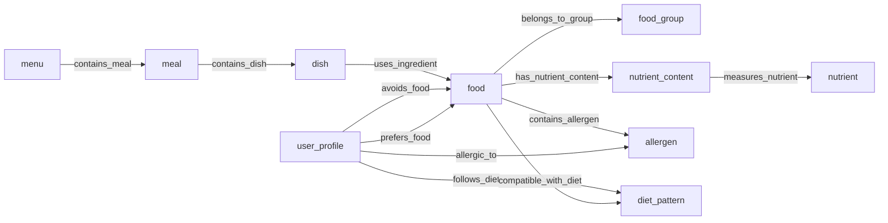

# Relations và ràng buộc

Định nghĩa nằm trong [relations.json](../kb/relations.json). Quan hệ mô tả cách hai loại đối tượng liên kết; Facts ghi các liên kết cụ thể.

## Bảng Relations theo mẫu slide

`signature` là cú pháp khẳng định (cột Positive rules), không phải luật IF–THEN. Nguồn chung: `source_th1`, `source_th2`, `source_design`, `source_slides`.

Properties: dx = đối xứng, px = phản xạ, bc = bắc cầu. 12 quan hệ đang nối hai Concept khác nhau nên chưa khai báo các tính chất này (`properties=[]`).

| Mã | Relation Name | Positive rules | Properties | Negative rules |
| --- | --- | --- | --- | --- |
| REL01 | `belongs_to_group` | `belongs_to_group(food, food_group)` | — | — |
| REL02 | `has_nutrient_content` | `has_nutrient_content(food, nutrient_content)` | — | — |
| REL03 | `measures_nutrient` | `measures_nutrient(nutrient_content, nutrient)` | — | — |
| REL04 | `uses_ingredient` | `uses_ingredient(dish, food)` | — | — |
| REL05 | `contains_allergen` | `contains_allergen(food, allergen)` | — | `Not(contains_allergen(food, allergen))` |
| REL06 | `allergic_to` | `allergic_to(user_profile, allergen)` | — | — |
| REL07 | `follows_diet` | `follows_diet(user_profile, diet_pattern)` | — | — |
| REL08 | `compatible_with_diet` | `compatible_with_diet(food, diet_pattern)` | — | `Not(compatible_with_diet(food, diet_pattern))` |
| REL09 | `contains_dish` | `contains_dish(meal, dish)` | — | — |
| REL10 | `contains_meal` | `contains_meal(menu, meal)` | — | — |
| REL11 | `avoids_food` | `avoids_food(user_profile, food)` | — | — |
| REL12 | `prefers_food` | `prefers_food(user_profile, food)` | — | — |

## Miền, miền giá trị, bội số và ràng buộc

`domain` là Concept của đầu vào (`subject_id`); `range` là Concept của đầu ra (`object_id`).
`objects_per_subject`: mỗi đầu vào có bao nhiêu đầu ra; `subjects_per_object`: mỗi đầu ra nhận bao nhiêu đầu vào.
`0..*` là không hoặc nhiều; `1..*` là ít nhất một; `1..1` là đúng một.

| Mã | Miền → miền giá trị | Bội số đầu ra/đầu vào; đầu vào/đầu ra | Ý nghĩa và ràng buộc |
| --- | --- | --- | --- |
| REL01 | `food` → `food_group` | 1..1; 0..* | Một thực phẩm thuộc đúng một nhóm phân loại chính trong bộ 6 nhóm của TH2. Mỗi food có một nhóm chính do thiết kế bài chọn; 6 nhóm được định nghĩa trong facts.entities.food_group. Không suy ra giàu protein từ group_protein. |
| REL02 | `food` → `nutrient_content` | 0..6; 1..1 | Liên kết thực phẩm với bản ghi định lượng trên 100 g phần ăn được, cùng trạng thái thực phẩm. Mỗi content có một chủ food; duy nhất (food, nutrient), tách Food khác ID khi trạng thái khác. Bản đủ có 6 content/food; value unknown là null, không phải 0. |
| REL03 | `nutrient_content` → `nutrient` | 1..1; 0..* | Bản ghi hàm lượng đo đúng một chất; đơn vị lấy từ Nutrient. Đơn vị lấy từ Nutrient, cơ sở 100 g phần ăn được. Bản known có value không âm, source_id và source_record_id; giữ trạng thái Food. |
| REL04 | `dish` → `food` | 1..*; 0..* | Một công thức sử dụng thực phẩm với định lượng cho toàn bộ công thức. amount_g > 0, unit = g, quantity_basis = recipe_total. Mỗi (dish, food) một cạnh; servings của món là số nguyên dương. Khối lượng phải ứng với food_state; dinh dưỡng sau chế biến cần hệ số riêng, không suy ra từ khối lượng tùy ý. |
| REL05 | `food` → `allergen` | 0..5; 0..* | Ghi nhận tác nhân dị ứng đã xác định trong một thực phẩm. Không có cạnh không có nghĩa là không có dị ứng. food.allergen_status là complete/unknown; complete chỉ hoàn tất kiểm tra bộ 5 tác nhân của TH2. Dị ứng của dish/meal/menu được hợp từ nguyên liệu và phải giữ đường dẫn truy vết. |
| REL06 | `user_profile` → `allergen` | 0..5; 0..* | Người dùng khai báo dị ứng với tác nhân trong danh mục. Là sự kiện đầu vào, không phải kiến thức chuyên môn. allergy_status = complete mới diễn giải tập rỗng là không khai báo dị ứng trong phạm vi bài. allergy_status = unknown khiến kết quả kiểm tra chưa xác định. |
| REL07 | `user_profile` → `diet_pattern` | 1..1; 0..* | Mỗi hồ sơ có đúng một chế độ ăn chính. Mỗi profile chọn đúng một diet_pattern chính trong bộ 3; đây là thiết kế của bài. diet_vegetarian là lacto-ovo; diet_vegan loại toàn bộ nguồn gốc động vật. |
| REL08 | `food` → `diet_pattern` | 0..3; 0..* | Cạnh khẳng định một thực phẩm được cho phép theo định nghĩa chế độ ăn đã chốt. food.diet_status = complete khi đã đánh giá cả 3 chế độ; khi đó thiếu cạnh là không phù hợp. Nếu diet_status = unknown, thiếu cạnh là chưa biết; không tự cho phép. Món phù hợp chỉ khi mọi nguyên liệu phù hợp; thiếu thông tin của một nguyên liệu thì chưa kết luận. |
| REL09 | `meal` → `dish` | 1..*; 0..* | Bữa ăn cụ thể chứa món với số khẩu phần được dùng. servings > 0; không trùng (meal, dish). Mỗi meal có meal_type = breakfast/lunch/dinner; cùng loại bữa có thể có nhiều instance. |
| REL10 | `menu` → `meal` | 3..3; 0..* | Thực đơn một ngày chứa đúng ba bữa sáng, trưa, tối. Bộ mẫu chọn scope=one_day, đúng một breakfast/lunch/dinner; đây là quyết định thiết kế, không phải suy từ việc đề bài có 3 loại bữa. Meal ID là instance, có thể tái sử dụng trong nhiều Menu. |
| REL11 | `user_profile` → `food` | 0..*; 0..* | Danh sách thực phẩm người dùng bắt buộc tránh. Ràng buộc cứng: loại cả món chứa thực phẩm cần tránh. avoid_status = unknown không được xem như danh sách rỗng đã xác nhận. Nếu đồng thời prefers_food = like, ràng buộc tránh thắng và ghi nhận xung đột. |
| REL12 | `user_profile` → `food` | 0..*; 0..* | Biểu diễn thích hoặc không thích thực phẩm để xếp hạng ứng viên. preference thuộc {like, dislike}; một (user, food) chỉ có một giá trị. Thiếu cạnh = không khai báo sở thích; đây là ưu tiên mềm. Chỉ xét sở thích sau khi vượt qua kiểm tra dị ứng, tránh và chế độ ăn. |

Các thuộc tính trên cạnh:

| Quan hệ | Thuộc tính và kiểu |
| --- | --- |
| REL04 | `{"amount_g": {"type": "number", "exclusive_minimum": 0}, "unit": {"const": "g"}, "quantity_basis": {"const": "recipe_total"}}` |
| REL09 | `{"servings": {"type": "number", "exclusive_minimum": 0}}` |
| REL12 | `{"preference": {"type": "enum", "values": ["like", "dislike"]}}` |

Đề yêu cầu làm rõ bội số và ràng buộc. Các lựa chọn **một nhóm chính/Food, một chế độ chính/User, đúng ba bữa/Menu một ngày** là quyết định của nhóm để có mô hình nhất quán. Khi thay đổi phạm vi phải sửa đồng bộ JSON, bảng và kiểm tra.

## Phủ định và dữ liệu thiếu

REL05/REL08 chỉ kết luận phủ định khi có cạnh trong `negative_edges` có nguồn, hoặc đã đánh giá đầy đủ danh mục tương ứng (`allergen_status/diet_status=complete`) và thiếu cạnh khẳng định. Khi `unknown`, thiếu cạnh chỉ có nghĩa chưa biết.

Không được đồng thời có cạnh khẳng định và phủ định cùng bộ `(relation, subject_id, object_id)`. Thiếu thông tin cần thiết đưa ứng viên về `requires_review`; sở thích không được bỏ qua dị ứng, tránh hoặc chế độ ăn.

## Sơ đồ tổng thể

